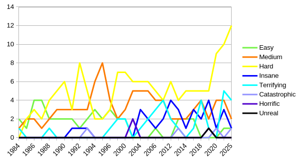

# IOCCC Deobfuscated

This repository has every IOCCC entry deobfuscated by Claude.

## What's New?

Each entry now has a deobfuscated simple.c source file in its directory.

The DIFFICULTIES.md file lists each entry under an obfuscation level. The levels
are easy, medium, hard, insane, terrifying, catastrophic, horrific, and unreal.

Here is a graph I made in LibreOffice which shows the number of entries for
each difficulty by year.

NOTE: there are two catastrophic and horrific entries in 2001 which overlap with
each other.

## What Did I Make?

I wrote everything under .claude/ myself which includes the prompts, templates,
and a Makefile used to automate the preprocessor deobfuscation. I wrote this
README myself. I created the graph of difficulties myself.

## Missing Entries

A few entries were removed by me explicitly and are missing from this
repository. The entries 2013/cable2, 2013/cable3, 2025/ferguson were removed
because they take a lot of storage. The entry birken/2014 was removed because I
didn't want to give the agent access to the network for it to run tests.

## How Was It Done?

There are two agents at work: the coordinator and the deobfuscator. I wrote a
"skill" file for both which is like a prompt you can call as a function.
Basically I just used the /coordinate skill passing each year as an argument.

### Deobfuscator

The deobfuscator is given a year/author as an argument to deobfuscate. It first
runs a Makefile I made to preprocess the original source file and format it to
create the simple.c file. The agent then works in the simple.c source file. The
goal with this was to get rid of prepreocessor obfuscation and minimize the
number of ways the agent could deviate in creating its deobfuscated file.

The best way I thought to have the agent check whether it broke the program
while deobfuscating was to copy the try.sh script and compare the output to the
original program. But many entries don't have a try.sh or it relies on some
input, graphics, randomness, etc., so entries without a reliable try.sh are
considered unverified.

After deobfuscation is finished, the agent chooses an arbitrary difficulty for
how hard the entry was to deobfuscate and describes the obfuscation techniques
in TECHNIQUES.md.

### Coordinator

The coordinator is given a year as an argument and is responsibile for assigning
an agent to deobfuscate each entry in the year. There is a PROGRESS.md file in
each year which the coordinator uses to track the status of each entry. Once the
agent is finished, the coordinator records the returned difficulty value in the
toplevel DIFFICULTIES.md and commits the changes.

## Oversights

It probably would have been useful to make the deobfuscator write any deviations
it took from prog.c in the entry TECHNIQUES.md file for unverified entries.
Unfortunately now this knowledge is lost because the agents no longer exist.

## Unexpected Things

I have not used .ai since 2022 so this was a strange experience for me. It is
kind of like programming because writing the prompts is just writing
instructions, but a lot of the times my instructions would cause things that I
didn't expect.

In context window that I deobfuscated multiple years, after the coordinator
finished /coordinate 2014 it started on 2015 without me prompting it.

The deobfuscator would often do verification beyond try.sh. Some did a
byte-by-byte comparison between the original binary and simple, some agents
wrote a fake Xlib/SDL/curses library to log drawing calls since there is no
graphical environment, and some attempted to make programs nondeterministic by
overriding `time()`, `getpid()`, and `rand()` with their own library.

## Analysis

Quines cannot really be completely deobfuscated because the the string used to
print the new program, which is often a large portion of the entry, cannot be
changed or the output will not match the original prog.c.

## Will I Add Future Entries?

Probably not. I was given everything I used for free. I would not give money to
these .ai companies.
